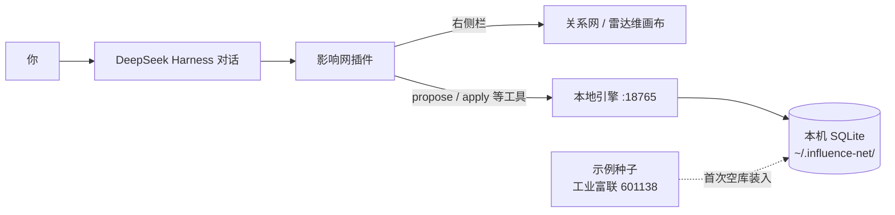

# 影响网 / influence-net

面向 A 股的影响分析工具：在 [DeepSeek Harness](https://github.com/deepseek-ai/deepseek-harness)（dsh）对话里把调研累积进「影响网」，在右侧栏即时看到关系网与八维雷达。

> 非投资建议。仓库内工业富联示例仅供演示。

## 产品效果

**左边对话补充调研，右边关系网即时更新**


**雷达维：八个维度一眼看结构**


**点开节点看详情与证据**


## 它做什么

- 本地引擎保存影响网（SQLite，默认 `~/.influence-net/`）
- 在 DeepSeek Harness（dsh）对话里用工具提出 / 确认写入
- 右侧栏画布：关系网、雷达维、近中远筛选与节点详情

## 架构



数据留在本机；对话只负责提出改动，确认后再写入。默认引擎地址：`http://127.0.0.1:18765`（可用 `INFLUENCE_NET_URL` / `INFLUENCE_NET_HOME` 覆盖）。

## 前置

已安装并可运行的 [DeepSeek Harness](https://github.com/deepseek-ai/deepseek-harness)（dsh）。也可参考[官网](https://deepseek.com/harness/)与[文档](https://deepseek-harness.github.io/deepseek-harness/)。

## 快速开始

### 1. 克隆并启动引擎

```bash
git clone https://github.com/jqlong17/influence-net.git
cd influence-net
./engine/run.sh
```

首次空库会自动装入工业富联（601138）示例网。

### 2. 在 DeepSeek Harness（dsh）中加载插件

```bash
dsh --patch /path/to/influence-net/cordis.yml
```

若改动了 `src/client/**`，先重建前端包（`DSH_ROOT` 指向 DeepSeek Harness 安装根目录）：

```bash
DSH_ROOT=/path/to/deepseek-harness npm run bundle:client
```

npm 包名：`influence-net`（可在 [DSH Plugin Hub](https://dshpluginhub.ai) 浏览 DeepSeek Harness 插件生态）。

### 3. 使用

1. 打开会话右侧栏 → **影响网**
2. 切换关系网 / 雷达维，点选节点查看详情
3. 常用工具：`influence_net_propose`、`influence_net_apply`、`influence_net_create_net`、`influence_net_load_example`

## 示例数据

`data/examples/fii-601138/` — 工业富联演示网，可用 `influence_net_load_example` 重新装入。

## Plugin Hub

仓库已标注 `dsh-plugin` / `deepseek-harness` topic，可在 [DSH Plugin Hub](https://dshpluginhub.ai) 作为源码或 npm 条目被发现。包名：`influence-net`。

## 测试

```bash
# 引擎
cd engine && PYTHONPATH=. python3 -m pytest ../tests/engine -q

# 插件（需本机 DeepSeek Harness，设置 DSH_ROOT）
DSH_ROOT=/path/to/deepseek-harness npx vitest run
```

## 相关链接

- 本插件：https://github.com/jqlong17/influence-net
- 产品页：https://influence.notta.uk
- DeepSeek Harness（dsh）：https://github.com/deepseek-ai/deepseek-harness
- 官网：https://deepseek.com/harness/
- 文档：https://deepseek-harness.github.io/deepseek-harness/
- Plugin Hub：https://dshpluginhub.ai

## License

MIT
