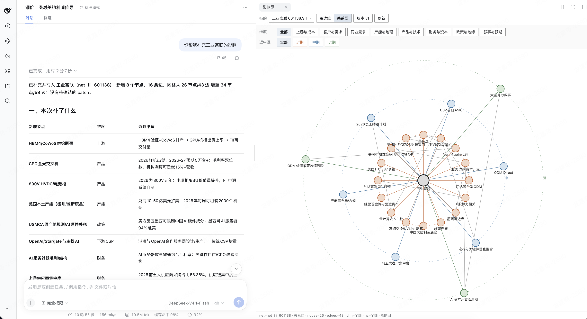
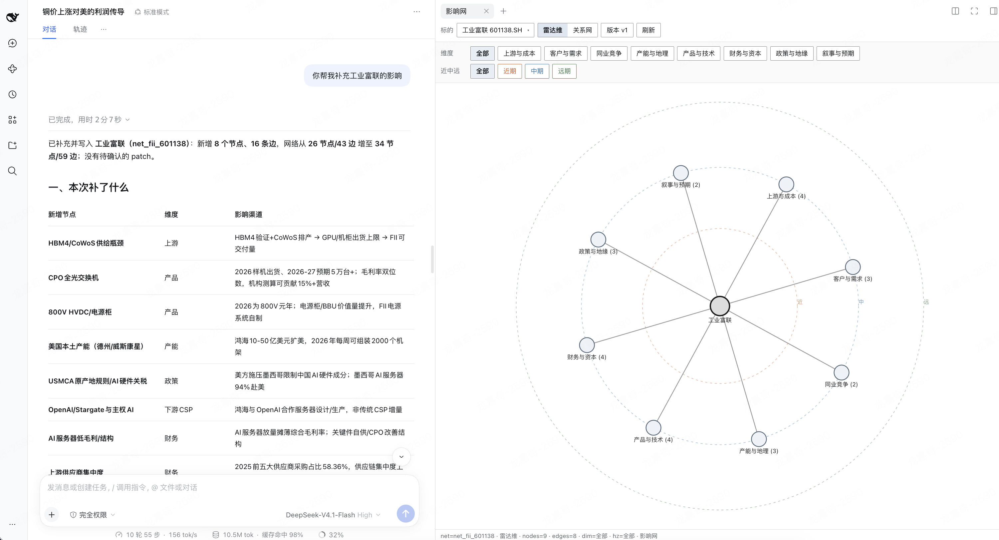
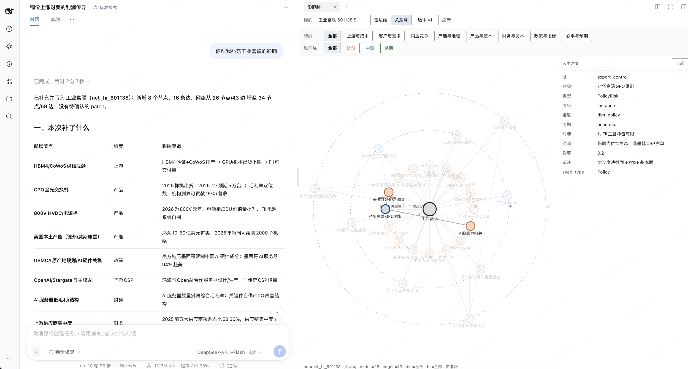
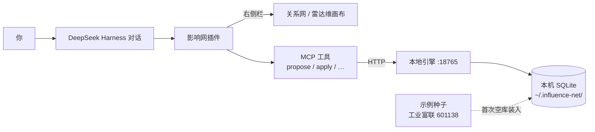

# 影响网 / influence-net

面向 A 股的影响分析工具：在 [DeepSeek Harness](https://github.com/deepseek-ai/deepseek-harness)（dsh）对话里把调研累积进「影响网」，在右侧栏即时看到关系网与八维雷达。

> 非投资建议。仓库内工业富联示例仅供演示。

## 产品效果

**左边对话补充调研，右边关系网即时更新**



**雷达维：八个维度一眼看结构**



**点开节点看详情与证据**



## 它做什么

- 本地引擎保存影响网（SQLite，默认 `~/.influence-net/`）
- 在 DeepSeek Harness（dsh）对话里用工具提出 / 确认写入
- 右侧栏画布：关系网、雷达维、近中远筛选与节点详情

## 架构



数据留在本机；对话只负责提出改动，确认后再写入。默认引擎地址：`http://127.0.0.1:18765`（可用 `INFLUENCE_NET_URL` / `INFLUENCE_NET_HOME` 覆盖）。

## 前置

已安装并可运行的 [DeepSeek Harness](https://github.com/deepseek-ai/deepseek-harness)（dsh）。也可参考[官网](https://deepseek.com/harness/)与[文档](https://deepseek-harness.github.io/deepseek-harness/)。

## 快速开始

### 1. 安装插件（推荐）

从 [DSH Plugin Hub](https://dshpluginhub.ai/zh/plugins/influence-net) 安装 `influence-net`，或：

```bash
# 在 dsh web profile 中安装后重启 / 打开会话即可
```

插件加载时会自动拉起本机 loopback 引擎（默认 `http://127.0.0.1:18765`）。可用 `INFLUENCE_NET_URL` 指定任意本机 HTTP 端口（如 `http://127.0.0.1:29111`），子进程会按同一 host/port 启动；远程 URL 不会自动拉起。**若数据目录还是空的，引擎会自动装入工业富联（601138）示例网**，右侧「标的」下拉里应能看到。也可设 `INFLUENCE_NET_SKIP_AUTOSTART=1` 关闭自动拉起。需要 Python 3 才能 spawn 引擎。

### 2. 开发：克隆并手动启动引擎

```bash
git clone https://github.com/jqlong17/influence-net.git
cd influence-net
./engine/run.sh
```

### 3. 开发：在 DeepSeek Harness（dsh）中加载插件

```bash
dsh --patch /path/to/influence-net/cordis.yml
```

开发构建（本仓库 `devDependencies` 已含 esbuild，无需强依赖 sibling harness）：

```bash
npm install --legacy-peer-deps
npm run build          # → lib/index.js + lib/client.js
npm test               # plugin vitest + engine pytest（需 Python3 + pytest）
npm run accept:pack    # npm pack 解包后真实 apply 冷启动验收（隔离 home/端口）
```

若在 DeepSeek Harness monorepo 旁开发，仍可用 `DSH_ROOT=/path/to/deepseek-harness` 复用其 esbuild。

npm 包名：`influence-net`（可在 [DSH Plugin Hub](https://dshpluginhub.ai) 浏览 DeepSeek Harness 插件生态）。

### 4. 使用

1. 打开会话右侧栏 → **影响网**
2. 切换关系网 / 雷达维，点选节点查看详情
3. 对话里用下面的 MCP 工具读写影响网（不要让模型用 bash / sqlite 直写库）

## MCP 工具

插件通过 DeepSeek Harness 注册下列工具；写入一律走本地引擎，结构性改动默认先挂起、确认后再落库。

| 工具 | 做什么 |
| --- | --- |
| `influence_net_status` | 检查插件是否加载、本地引擎是否可达 |
| `influence_net_get_graph` | 读取当前网；`view=instance` 关系网，`view=abstract` 雷达维 |
| `influence_net_list_nets` | 列出已有标的网与当前激活的 `net_id` |
| `influence_net_create_net` | 按模版新建空白网（中心 + 八维空壳，不拷贝别的票） |
| `influence_net_activate_net` | 切换当前激活的网 |
| `influence_net_load_example` | 装入内置示例（默认工业富联 601138） |
| `influence_net_propose` | 用自然语言提出改图；低风险叙述可自动写入，中高风险挂 pending |
| `influence_net_pending` | 查看待确认的改动 |
| `influence_net_apply` | 用户明确确认后，写入某条 pending |
| `influence_net_reject` | 拒绝某条 pending，不写入 |
| `influence_net_bulk_seed` | 批量装入节点/边结构；默认需确认，禁止编造 strength |

约定简述：真源优先保留用户原话；`public` 归因至少要有可核验的发行人/主流媒体证据 URL，否则降为 `weak`；不要绕过工具直接改 SQLite。

## 示例数据

`data/examples/fii-601138/` — 工业富联演示网，可用 `influence_net_load_example` 重新装入。

## Plugin Hub

仓库已标注 `dsh-plugin` / `deepseek-harness` topic，可在 [DSH Plugin Hub](https://dshpluginhub.ai) 作为源码或 npm 条目被发现。包名：`influence-net`。

## 测试

```bash
# 引擎
cd engine && PYTHONPATH=. python3 -m pytest ../tests/engine -q

# 插件（需本机 DeepSeek Harness，设置 DSH_ROOT）
DSH_ROOT=/path/to/deepseek-harness npx vitest run
```

## 相关链接

- 本插件：https://github.com/jqlong17/influence-net
- 产品页：https://influence.notta.uk
- DeepSeek Harness（dsh）：https://github.com/deepseek-ai/deepseek-harness
- 官网：https://deepseek.com/harness/
- 文档：https://deepseek-harness.github.io/deepseek-harness/
- Plugin Hub：https://dshpluginhub.ai

## License

MIT
